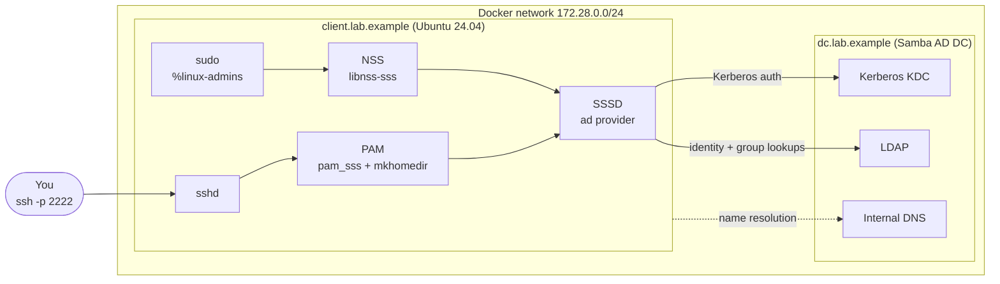

# linux-identity-lab

A disposable lab that joins a Linux host to an Active Directory domain using
SSSD and PAM. It runs a Samba AD domain controller and a Linux client in Docker
Compose, then proves the integration end to end: user lookup, password login,
group-based access control and sudo. Everything is demo data created from
scratch; nothing comes from any real environment.

> **Demo credentials only.** The passwords in `.env.example` are public and
> the lab is meant to run on your own machine and be thrown away. Do not reuse
> them or expose the lab's ports to a network.

## Architecture



## What it demonstrates

| Area | How it is shown |
|------|-----------------|
| Domain join | `adcli join` creates the `CLIENT$` computer account and keytab |
| Identity (NSS) | `getent passwd alice` returns AD users with UIDs mapped from SIDs |
| Authentication (PAM) | `pam_sss` validates passwords against Kerberos on the DC |
| Access control | `ad_access_filter` lets only members of `linux-users` log in |
| Privilege | `%linux-admins` in sudoers grants sudo to an AD group |
| Home directories | `pam_mkhomedir` creates `/home/<user>` at first login |

Demo directory: users `alice` (linux-users and linux-admins), `bob`
(linux-users) and `carol` (neither). Carol exists in AD but is denied login,
which shows that authentication and authorisation are separate decisions.

## Run it

Requires Docker with Compose v2.

```bash
make up        # build images and start the DC and client (first start takes a few minutes)
make verify    # run the end-to-end checks
make shell     # open a shell on the client
make reset     # destroy everything, including the domain data
```

Try it by hand:

```bash
ssh -p 2222 alice@127.0.0.1      # password: Lab-User-Passw0rd!
id                               # shows AD groups
sudo -l                          # allowed: alice is in linux-admins
```

Then try `bob` (can log in, cannot sudo) and `carol` (login denied).

## How it works

1. The DC image provisions a domain (`samba-tool domain provision`) on first
   start and seeds OUs, users and groups.
2. The client waits for the DC, then joins with `adcli join`, which stores the
   machine's Kerberos keytab in `/etc/krb5.keytab`.
3. SSSD uses that keytab to query LDAP, and PAM sends logins to SSSD, which
   authenticates against Kerberos.
4. `ldap_id_mapping = True` derives UIDs and GIDs from AD SIDs, so no POSIX
   attributes are needed on the directory objects.

Key config lives in `client/sssd.conf.tmpl`, `client/krb5.conf` and
`client/entrypoint.sh`.

## Testing

`scripts/verify.sh` runs 13 checks (join, lookups, logins, denied login, wrong
password, group membership, sudo allowed and denied). GitHub Actions lints the
shell scripts and Dockerfiles, then starts the lab and runs the same script.

## Design notes

- **Samba AD stands in for Microsoft AD.** SSSD talks to it with the same
  `ad` provider, so the Linux-side configuration carries over to a real domain.
- **GPO access control is disabled** (`ad_gpo_access_control = disabled`)
  because Samba does not serve full Windows GPOs. On a real AD domain you
  would normally use GPO-based or `ad_access_filter` controls.
- **Password SSH is enabled for testing only.** In production, use keys or
  Kerberos (GSSAPI) with MFA.
- **Relation to Entra ID:** Entra ID does not speak Kerberos/LDAP to Linux
  directly. Hybrid setups usually use Entra Domain Services or a synced
  on-premises AD, then join Linux the same way as here.

## Troubleshooting

| Symptom | Check |
|---------|-------|
| `make up` times out waiting for `dc` | `make logs`; provisioning needs xattr support on the Docker storage driver |
| Join fails with a DNS error | The client must use the DC as resolver (`dns:` in compose); run `docker compose exec client getent hosts dc.lab.example` |
| `getent passwd alice` is empty | `docker compose exec client sssctl domain-status lab.example`; check `/var/log/sssd` or `make logs` |
| Login denied for everyone | Check `ad_access_filter` and that `alice` is in `linux-users` (`samba-tool group listmembers linux-users` on the DC) |
| Kerberos clock-skew errors | Both containers share the host clock; restart Docker if the host clock jumped |

## Roadmap

- FreeIPA and Keycloak variants for comparison
- SSH with Kerberos (GSSAPI) single sign-on
- LDAPS with a lab CA
- Ansible role to apply the SSSD configuration to real hosts

## Licence

MIT
